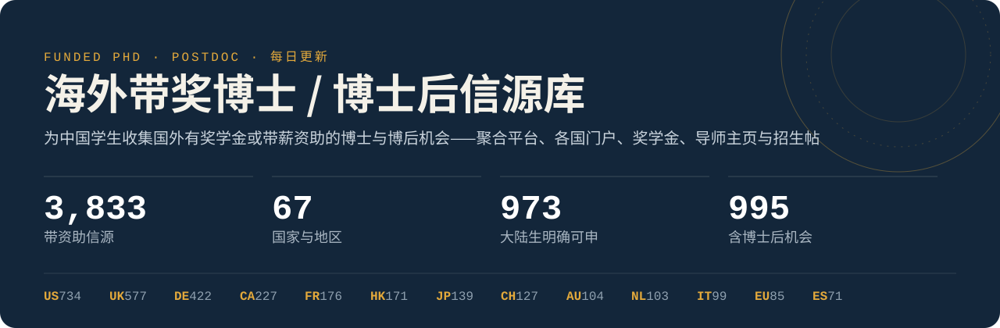

<p align="center">

</p>

<p align="center">
<a href="SOURCES.md"></a>
<a href="SOURCES.md#按国家--地区"></a>
<a href="SOURCES.md#按学科"></a>
<br>
<a href="data/jobs.md"></a>
<a href="reports/discovery.md"></a>
<a href="docs/guide-cn.md"></a>
</p>

<!-- STATS:START -->
**热门地区：** [美国](sources/region/us.md) 397 · [德国](sources/region/de.md) 296 · [英国](sources/region/uk.md) 292 · [中国香港](sources/region/hk.md) 134 · [加拿大](sources/region/ca.md) 127 · [法国](sources/region/fr.md) 117 · [全球](sources/region/global.md) 104 · [瑞士](sources/region/ch.md) 89 · [日本](sources/region/jp.md) 80 · [澳大利亚](sources/region/au.md) 70 · [荷兰](sources/region/nl.md) 66 · [欧盟/欧洲](sources/region/eu.md) 57 · [全部 →](SOURCES.md#按国家--地区)

**学科：** [全学科](sources/discipline/all.md) 669 · [生物/生命科学](sources/discipline/bio.md) 399 · [工程](sources/discipline/engineering.md) 343 · [计算机](sources/discipline/cs.md) 326 · [物理/天文](sources/discipline/physics.md) 282 · [社会科学/心理](sources/discipline/social.md) 254 · [医学/公卫](sources/discipline/med.md) 249 · [化学/材料](sources/discipline/chem.md) 214 · [人文/语言](sources/discipline/humanities.md) 189 · [人工智能](sources/discipline/ai.md) 187 · [数学/统计](sources/discipline/math.md) 161 · [经济/金融](sources/discipline/econ.md) 117 · [神经/认知](sources/discipline/neuro.md) 108 · [地球/环境/海洋](sources/discipline/geo.md) 99 · [商科/管理](sources/discipline/business.md) 82 · [生态/进化](sources/discipline/eco.md) 75
<!-- STATS:END -->

> **[现在可以申请的带奖博士 / 博后 →](OPEN.md)**：每条都由核实员打开官网确认“今天仍可申请”，附官网原句，按截止日期排序；截止后自动移出。

图例：✅ 中国大陆学生可申 · 🟡 部分可申 / 有名额限制 · ❔ 需逐条核实 · ⛔ 不可申（仅作提醒）

## 怎么用这份清单

1. **先读[申请指南](docs/guide-cn.md)**：各国“带奖”的含义、申请时间线、国际生名额、学费差额、CSC 限制与安全审查。
2. **挑信源**：在[信源总目录](SOURCES.md)里按国家或学科进入分页，把适合你的平台加入收藏，订阅邮件提醒或 RSS。
3. **每周刷新**：看[今日新岗位](data/jobs.md)，以及[发现报告](reports/discovery.md)里新冒出来的在招导师。
4. **盯导师**：很多名额只出现在导师主页和小红书 / 知乎 / X 的招生帖里，“导师招生帖”和“个人信源”两类专门收录这些。

> [!WARNING]
> 奖学金政策、国籍限制和截止日期每年都在变，所有信息仅供参考，**请以官方页面为准**。

## 信源分类

| 分类 | 收录什么 |
| --- | --- |
| [结构化博士项目](sources/category/doctoral-programs.md) | 研究生院、博士训练中心、研究所统一招生项目（IMPRS、ELLIS、UKRI DLA、KAUST、OIST …） |
| [高校旗舰奖学金](sources/category/university-schemes.md) | 各校全奖与校内奖学金检索（Gates、Clarendon、港校 RPg 奖学金、澳洲 RTP …） |
| [博士后奖学金与项目](sources/category/postdoc-fellowships.md) | MSCA PF、洪堡、JSPS、EMBO、HFSP、Newton、Banting 等 |
| [综合聚合平台](sources/category/aggregators.md) | FindAPhD、EURAXESS、Academic Positions、jobs.ac.uk 等跨国职位库 |
| [政府与国家级奖学金](sources/category/gov-scholarships.md) | CSC 公派、DAAD、HKPFS、SINGA、MEXT、瑞士卓越奖学金等 |
| [各国招聘门户](sources/category/national-portals.md) | AcademicTransfer（荷）、Jobbnorge（挪）、academics.de（德）、ABG（法）等 |
| [学科专属信源](sources/category/discipline.md) | 各学科邮件列表与职位板（Connectionists、EvolDir、comp-neuro …） |
| [企业与基金会 Fellowship](sources/category/fellowships.md) | Google、NVIDIA、Apple、AAUW 等在读博士资助 |
| [导师招生帖](sources/category/recruiting-posts.md) · [个人信源](sources/category/people-channels.md) | 导师在小红书、知乎、公众号、X、Bluesky、LinkedIn 发布的招生帖，及主页挖掘方法 |
| [导师招生汇总](sources/category/faculty-aggregators.md) | 列出“正在招生导师”的表格与数据库（AIOpenings、Drafty 等） |
| [科研实习](sources/category/pathways.md) · [中文社区](sources/category/chinese-community.md) · [GitHub 资源](sources/category/github-resources.md) · [工具](sources/category/tools.md) | 暑研入口、中文论坛、开源申请资料、选校工具 |

## 数据每天自动更新

读者不需要做任何事，以下任务持续维护本仓库：

- **研究员（每 2 小时）**：按“学科 × 国家 × 平台”切片检索新信源并去重入库，同时核实不确定的信息（失效链接、国际生资格）。
- **导师发现（每天 2 次）**：轮换扫描数万个教授主页的招生表述、Bluesky 招生帖、AIOpenings 招生表与 GitHub 新汇总。
- **岗位抓取（每天）**：EURAXESS、jobs.ac.uk、AcademicTransfer、Jobbnorge、Varbi、DAAD 等十余个来源。
- **链接核查（每次更新）**：真实访问每个链接，结果见[信源可用性报告](reports/source-health.md)。

**下载数据：** [sources.csv](data/export/sources.csv) · [sources.json](data/export/sources.json) · [jobs.csv](data/export/jobs.csv) · [faculty.csv](data/export/faculty.csv)　**数据中台**（私密，仅仓库主人可打开）：[带奖博士信源中台](https://claude.ai/artifact/H6iN9qSZrRiSUN6disBdZA)

<details>
<summary><b>项目结构</b></summary>

```
_data/sources.yml, _data/sources_extra/   信源数据（唯一数据源）
SOURCES.md, sources/                      自动生成的阅读页面（总目录 + 分类/地区/学科分页）
docs/assets/                              首页 SVG 横幅与导航卡片（随数据自动生成）
data/export/                              机器可读数据（CSV / JSON / 统计历史）
dashboard/template.html                   数据中台页面模板
data/jobs.*, data/discovery/              每日岗位与导师发现结果
scrapers/, discovery/, scripts/           抓取器、发现流程与生成脚本
research/                                 持续研究的切片与收件箱
docs/guide-cn.md                          中国学生申请指南
```

</details>

## 参与贡献

发现遗漏的信源或失效链接，欢迎开 Issue 或 PR。数据格式见 [CONTRIBUTING.md](CONTRIBUTING.md)：在 `_data/sources.yml` 中添加条目即可，页面会自动重新生成。

## 许可与免责

数据按 [CC BY 4.0](DATA-LICENSE.md) 提供，代码按 [MIT](LICENSE) 许可。所有信息以官方页面为准，详见 [数据许可与免责声明](DATA-LICENSE.md)。
